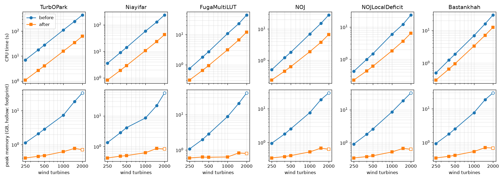
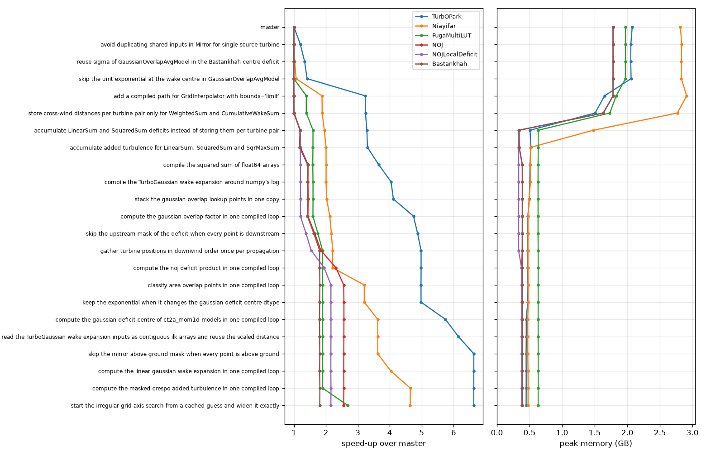

# Results

Upstream `master` (before, `586aec8e`) against `performance` (after, library code at `e578ba85`).
Every change keeps the simulation results byte-identical to `master`, and no upstream test that
passes on `master` fails on `performance`.

- 1.9-7.1x faster on one thread on farms of 400-2000 turbines: TurbOPark (`Nygaard_2022`) 6.6-7.1x,
  Niayifar 4.7-5.5x, FugaMultiLUT 2.8-3.7x, NOJ 2.7-4.2x, `NOJLocalDeficit` 2.3-3.7x, Bastankhah
  1.9-2.4x.
- 3-68x less peak memory. After, it stays under 1 GB up to 2000 turbines (0.38-0.64 GB at 400).
  `master` grows with the square of the turbine count and needs 29-56 GB at 2000 turbines,
  where its RSS saturates at 22-26 GB on this 36 GB machine and macOS compresses the rest.
- `WS_eff`, `TI_eff`, `CT`, `Power` and AEP are byte-identical (`tobytes()`) to `master` on every
  benchmark case below.

## Before and after

Apple M4 Max (36 GB RAM), Python 3.12.16, numpy 2.5.4, numba 0.68.0, xarray 2026.9.0, one thread.
Models (`cases.py`): TurbOPark is `Nygaard_2022`, Niayifar is `Niayifar_PorteAgel_2016`, NOJ is `NOJ`,
`NOJLocalDeficit` uses `ct2a_mom1d`, area overlap and `LinearSum` in `PropagateDownwind`, Bastankhah
is `IEA37SimpleBastankhahGaussian` and FugaMultiLUT is `FugaMultiLUTDeficit` with two LUTs. Farms: two turbine types, 72 wind directions x 22 wind speeds (`scale<N>` in `cases.py`; `scale400`
is `grid400`). Times are the CPU time of one simulation call, the median over fresh processes that
alternate before and after (400 turbines: 5 pairs, 1000 and 1500: 3 pairs, 2000: 1 pair). Memory is
the peak RSS of the process, except at 2000 turbines: `master` no longer fits in RAM there (its RSS
saturates at 22-26 GB while macOS compresses the rest), so that row shows the physical footprint, and
`master`'s time there includes compression and paging. Each process at 2000 turbines ran one
simulation, so the after times there include numba compilation. At 1500 turbines the footprint of `master`
was 32.1 GB for Niayifar and 23.1 GB for FugaMultiLUT, above the RSS shown.

| Farm | Model | Time before | Time after | Speed-up | Memory before | Memory after | Less memory |
| --- | --- | ---: | ---: | ---: | ---: | ---: | ---: |
| 400 WTGs | TurbOPark | 17.8 s | 2.7 s | 6.6x | 2.09 GB | 0.45 GB | 4.6x |
| | Niayifar | 9.0 s | 1.9 s | 4.7x | 2.84 GB | 0.49 GB | 5.8x |
| | FugaMultiLUT | 1.8 s | 0.65 s | 2.8x | 1.99 GB | 0.64 GB | 3.1x |
| | NOJ | 1.2 s | 0.45 s | 2.7x | 1.78 GB | 0.38 GB | 4.7x |
| | NOJLocalDeficit | 1.0 s | 0.44 s | 2.3x | 1.80 GB | 0.38 GB | 4.7x |
| | Bastankhah | 1.2 s | 0.65 s | 1.9x | 1.78 GB | 0.39 GB | 4.6x |
| 1000 WTGs | TurbOPark | 111 s | 15.7 s | 7.0x | 7.39 GB | 0.62 GB | 12x |
| | Niayifar | 58.1 s | 10.8 s | 5.4x | 8.59 GB | 0.63 GB | 14x |
| | FugaMultiLUT | 10.9 s | 3.2 s | 3.5x | 8.83 GB | 0.64 GB | 14x |
| | NOJ | 6.9 s | 1.9 s | 3.7x | 7.65 GB | 0.53 GB | 15x |
| | NOJLocalDeficit | 5.9 s | 1.8 s | 3.2x | 8.53 GB | 0.52 GB | 16x |
| | Bastankhah | 6.9 s | 3.3 s | 2.1x | 7.66 GB | 0.54 GB | 14x |
| 1500 WTGs | TurbOPark | 246 s | 34.7 s | 7.1x | 18.6 GB | 0.78 GB | 24x |
| | Niayifar | 127 s | 23.5 s | 5.4x | 21.6 GB | 0.87 GB | 25x |
| | FugaMultiLUT | 23.2 s | 6.6 s | 3.5x | 20.7 GB | 0.83 GB | 25x |
| | NOJ | 15.1 s | 3.8 s | 4.0x | 18.6 GB | 0.68 GB | 27x |
| | NOJLocalDeficit | 12.2 s | 3.7 s | 3.3x | 18.7 GB | 0.67 GB | 28x |
| | Bastankhah | 16.0 s | 7.1 s | 2.3x | 18.6 GB | 0.71 GB | 26x |
| 2000 WTGs | TurbOPark | 443 s | 62.7 s | 7.1x | 33.3 GB | 0.71 GB | 47x |
| | Niayifar | 236 s | 42.6 s | 5.5x | 56.3 GB | 0.83 GB | 68x |
| | FugaMultiLUT | 45.1 s | 12.2 s | 3.7x | 40.7 GB | 0.80 GB | 51x |
| | NOJ | 28.2 s | 6.7 s | 4.2x | 29.5 GB | 0.63 GB | 47x |
| | NOJLocalDeficit | 23.8 s | 6.5 s | 3.7x | 32.3 GB | 0.63 GB | 51x |
| | Bastankhah | 29.8 s | 12.5 s | 2.4x | 29.4 GB | 0.69 GB | 43x |



In the chart, 250 and 500 turbines are included (`scale250`, `scale500`) and hollow markers are the
physical footprint, as in the 2000 row.

## Where the gain comes from

`grid400` (400 turbines), 3 alternating pairs per commit, median CPU time; the cumulative speed-up
over `master` is in brackets. Each row is one commit on `performance`, oldest first. These are
separate runs from the table above, so the last row differs from its 400-turbine rows by up to 0.1x.



| Commit | Change | TurbOPark | Niayifar | FugaMultiLUT | NOJ | NOJLocalDeficit | Bastankhah |
| --- | --- | ---: | ---: | ---: | ---: | ---: | ---: |
| 586aec8e | master | 17.7 s | 8.9 s | 1.7 s | 1.2 s | 0.94 s | 1.2 s |
| 8bd94fcf | avoid duplicating shared inputs in Mirror for single source turbine | 14.8 s (1.2x) | 8.9 s (1.0x) | 1.7 s (1.0x) | 1.2 s (1.0x) | 0.95 s (1.0x) | 1.2 s (1.0x) |
| c9ebc42f | reuse sigma of GaussianOverlapAvgModel in the Bastankhah centre deficit | 13.3 s (1.3x) | 8.7 s (1.0x) | 1.7 s (1.0x) | 1.2 s (1.0x) | 0.94 s (1.0x) | 1.2 s (1.0x) |
| 8c573e7f | skip the unit exponential at the wake centre in GaussianOverlapAvgModel | 12.5 s (1.4x) | 8.4 s (1.1x) | 1.7 s (1.0x) | 1.2 s (1.0x) | 0.94 s (1.0x) | 1.2 s (1.0x) |
| 91026a1a | add a compiled path for GridInterpolator with bounds='limit' | 5.5 s (3.2x) | 4.8 s (1.9x) | 1.3 s (1.4x) | 1.1 s (1.0x) | 0.94 s (1.0x) | 1.2 s (1.0x) |
| 6c5ac130 | store cross-wind distances per turbine pair only for WeightedSum and CumulativeWakeSum | 5.5 s (3.2x) | 4.7 s (1.9x) | 1.3 s (1.4x) | 1.2 s (1.0x) | 0.94 s (1.0x) | 1.2 s (1.0x) |
| 444b22fa | accumulate LinearSum and SquaredSum deficits instead of storing them per turbine pair | 5.4 s (3.3x) | 4.6 s (1.9x) | 1.1 s (1.6x) | 0.96 s (1.2x) | 0.78 s (1.2x) | 0.98 s (1.2x) |
| b4dbc808 | accumulate added turbulence for LinearSum, SquaredSum and SqrMaxSum | 5.4 s (3.3x) | 4.5 s (2.0x) | 1.1 s (1.6x) | 0.96 s (1.2x) | 0.79 s (1.2x) | 1.0 s (1.2x) |
| 6a471928 | compile the squared sum of float64 arrays | 4.8 s (3.7x) | 4.5 s (2.0x) | 1.1 s (1.6x) | 0.80 s (1.4x) | 0.78 s (1.2x) | 0.82 s (1.4x) |
| 54ba9a7c | compile the TurboGaussian wake expansion around numpy's log | 4.4 s (4.0x) | 4.5 s (2.0x) | 1.1 s (1.6x) | 0.80 s (1.4x) | 0.78 s (1.2x) | 0.82 s (1.4x) |
| 40dd8c0c | stack the gaussian overlap lookup points in one copy | 4.3 s (4.1x) | 4.4 s (2.0x) | 1.1 s (1.6x) | 0.80 s (1.4x) | 0.78 s (1.2x) | 0.82 s (1.4x) |
| 05821714 | compute the gaussian overlap factor in one compiled loop | 3.7 s (4.7x) | 4.2 s (2.1x) | 1.1 s (1.6x) | 0.80 s (1.4x) | 0.78 s (1.2x) | 0.82 s (1.4x) |
| 2904321a | skip the upstream mask of the deficit when every point is downstream | 3.6 s (4.9x) | 4.1 s (2.2x) | 0.99 s (1.7x) | 0.70 s (1.6x) | 0.68 s (1.4x) | 0.72 s (1.6x) |
| 520c9244 | gather turbine positions in downwind order once per propagation | 3.6 s (5.0x) | 4.0 s (2.2x) | 0.92 s (1.9x) | 0.62 s (1.8x) | 0.61 s (1.5x) | 0.65 s (1.8x) |
| 0072a0fd | compute the noj deficit product in one compiled loop | 3.6 s (5.0x) | 4.0 s (2.2x) | 0.92 s (1.9x) | 0.50 s (2.3x) | 0.48 s (1.9x) | 0.65 s (1.8x) |
| 8ef373f7 | classify area overlap points in one compiled loop | 3.6 s (5.0x) | 2.8 s (3.2x) | 0.91 s (1.9x) | 0.45 s (2.6x) | 0.44 s (2.2x) | 0.65 s (1.8x) |
| 591feb4c | keep the exponential when it changes the gaussian deficit centre dtype | 3.6 s (5.0x) | 2.8 s (3.2x) | 0.92 s (1.9x) | 0.45 s (2.6x) | 0.44 s (2.2x) | 0.65 s (1.8x) |
| 411be422 | compute the gaussian deficit centre of ct2a_mom1d models in one compiled loop | 3.1 s (5.7x) | 2.5 s (3.6x) | 0.91 s (1.9x) | 0.45 s (2.6x) | 0.44 s (2.2x) | 0.65 s (1.8x) |
| 7bb4b247 | read the TurboGaussian wake expansion inputs as contiguous ilk arrays and reuse the scaled distance | 2.9 s (6.2x) | 2.5 s (3.6x) | 0.91 s (1.9x) | 0.45 s (2.6x) | 0.44 s (2.2x) | 0.65 s (1.8x) |
| 43565f2e | skip the mirror above ground mask when every point is above ground | 2.7 s (6.6x) | 2.5 s (3.6x) | 0.92 s (1.9x) | 0.45 s (2.6x) | 0.44 s (2.2x) | 0.65 s (1.8x) |
| 05a87613 | compute the linear gaussian wake expansion in one compiled loop | 2.7 s (6.6x) | 2.2 s (4.0x) | 0.91 s (1.9x) | 0.45 s (2.6x) | 0.44 s (2.2x) | 0.65 s (1.8x) |
| 5ec051b2 | compute the masked crespo added turbulence in one compiled loop | 2.7 s (6.6x) | 1.9 s (4.6x) | 0.92 s (1.9x) | 0.45 s (2.6x) | 0.44 s (2.2x) | 0.65 s (1.8x) |
| e578ba85 | start the irregular grid axis search from a cached guess and widen it exactly | 2.7 s (6.6x) | 1.9 s (4.6x) | 0.65 s (2.7x) | 0.45 s (2.6x) | 0.44 s (2.2x) | 0.65 s (1.8x) |

Peak memory drops mostly at one point: accumulating the superposition per turbine instead of
storing every turbine pair's deficit (`444b22fa`, and `b4dbc808` for Niayifar's added turbulence).
From there it stays at 0.33-0.63 GB on `grid400` and, as the scaling chart shows, grows far slower
than the farm.

## Method

- `speed.py` runs every case in a fresh process with one thread (`NUMBA_NUM_THREADS=1` and the BLAS
  equivalents), alternating `master` and `performance`, and runs `gc.collect()` before each timed
  simulation. The tables show the second simulation in each process. The first is 0.2-1.6 s slower
  after, which includes numba compilation, and up to 0.5 s slower before (up to 1.6 s at 1500
  turbines). The new kernels are compiled lazily and not cached on disk (no `cache=True`). The 1500
  and 2000 turbine runs used `--min-free 0`, because `master` needs more memory there than the
  default guard allows.
- `waterfall.py` times `master` and each commit on `performance` that changes `py_wake/` outside the
  tests, in detached worktrees, alternating the order between pairs.
- `identity.py` saves `WS_eff`, `TI_eff`, `CT`, `Power` and total AEP from each checkout and compares
  them bytewise.
- `tables.py` and `charts.py` turn the JSON reports into these tables and charts.

The commands, from `bench/` with `master` and `performance` checked out next to each other
(`M` is the six models):

```sh
M="turbopark niayifar fugamultilut noj nojlocal bastankhah"
cases() { for m in $M; do printf "%s-%s " "$m" "$1"; done; }
python speed.py --base ../../master --head .. --pairs 5 --runs 2 --out headline.json
python speed.py --base ../../master --head .. --pairs 3 --runs 2 --out scale-small.json \
  --cases $(cases scale250) $(cases scale500) $(cases scale1000)
python speed.py --base ../../master --head .. --pairs 3 --runs 2 --min-free 0 --out scale1500.json \
  --cases $(cases scale1500)
python speed.py --base ../../master --head .. --pairs 1 --runs 1 --min-free 0 --timeout 10800 \
  --out scale2000.json --cases $(cases scale2000)
python waterfall.py --repo .. --commits master master..e578ba85 --workdir ../../waterfall --pairs 3 \
  --runs 2 --out waterfall.json --cases $(cases grid400)
python tables.py compare headline.json scale-small.json scale1500.json --footprint scale2000.json \
  --farms 400 1000 1500 2000
python tables.py waterfall waterfall.json
python charts.py scaling headline.json scale-small.json scale1500.json --footprint scale2000.json \
  --out scaling.png
python charts.py waterfall waterfall.json --out waterfall.png
```

## Exactness

`identity.py` compared `master` and `performance` on 49 cases: the 19 default cases (`hr1`,
`grid400` and `aligned100` for the six models, `fuga` on `hr1`) and `scale250`, `scale500`, `scale1000`,
`scale1500` and `scale2000` for the six models in the table. `WS_eff`, `TI_eff`, `CT`, `Power` and
AEP are byte-identical in every case.

- The new kernels use only `+ - * /`, `sqrt`, `min`, `max`, `abs`, `floor` and comparisons, in numpy's order
  of operations. `log`, `exp`, `arccos` and powers stay in numpy. They use no `fastmath`, no float32
  and no reassociation, and their IR contains no fused multiply-add.
- Accumulating the superposition per turbine reproduces numpy's sum because numpy reduces axis 0 of
  a C-ordered array sequentially when each row holds more than one value; the accumulating path is
  only taken in that case.
- Every compiled path is guarded: it runs only with the numpy backend on real float64 arrays.
  Autograd, complex-step and `Numpy32` inputs fall back to the stock code, so gradients keep working.
- Compiled kernels do not emit numpy's floating-point `RuntimeWarning`s and ignore `np.errstate`.

The upstream test suite was run on both checkouts on the same day and machine (`pytest py_wake/tests
-n 8`). `performance` runs 1876 tests (`master` 1345; the fork adds tests for its compiled paths, guards
and fallbacks). Both fail exactly the same 24 tests and 3 collection errors in this
environment: optional packages that are not installed (load surrogates, line profiling), downloads
from DTU servers that were unreachable during the run, five notebooks, one parallelization test, one
NEWA Weibull test and 11 blockage-model gradient tests. `test_model_gradients.py` run alone also
fails the same 11 tests on both.

## Notes for upstream

- py_wake already depends on numba (`shadow_models`), so the kernels add no dependency.
- `test_memory_usage` always passes: it unpacks the `(result, memory)` pair of
  `check_memory_usage` in the wrong order, so it compares the simulation result instead of the
  memory.
- Two kernels started from candidates found with OpenEvolve, an LLM-driven code search: the fused
  Gaussian overlap factor and the guessed search on irregular grid axes. Both were ported by hand
  and pass the same identity and test checks as the rest.
